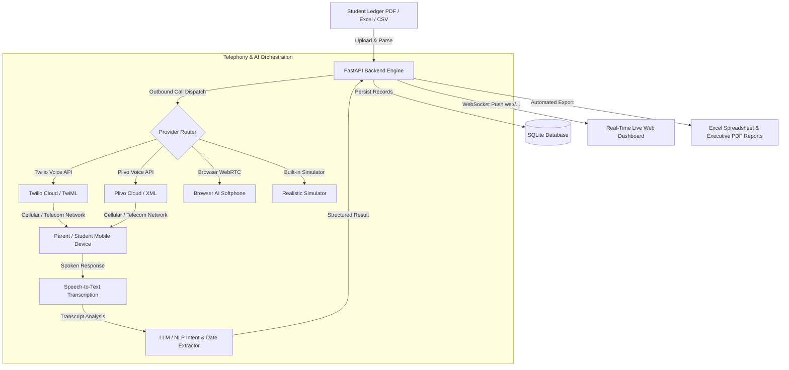

# 🎙️ ApexVoice AI — Automated Outbound Voice AI Fee Collection System

[](https://www.python.org/)
[](https://fastapi.tiangolo.com/)
[](https://groq.com/)
[](https://www.twilio.com/)
[](https://www.plivo.com/)
[](LICENSE)

An enterprise-ready, automated outbound Conversational Voice AI system designed for schools, universities, coaching institutes, and educational organizations. 

The system automates the tedious accounts follow-up process: it ingests student fee rosters from **Excel (`.xlsx`, `.csv`)** or **PDF fee dues ledgers**, automatically places real telephone calls via **Twilio** or **Plivo**, speaks the pending tuition fee amount and due date in natural Indian English (`Polly.Aditi`), actively listens for the recipient's spoken response, understands their payment commitment or dispute using **Conversational AI / LLM extraction**, logs results in real time on a live web dashboard, and automatically exports updated **Excel spreadsheets** and **Executive PDF Audit Reports**.

---

## 📑 Table of Contents
- [Architecture & Workflow](#-architecture--workflow)
- [Key Features](#-key-features)
- [Telephony Providers Supported](#-telephony-providers-supported)
- [Quick Start Guide](#-quick-start-guide)
- [Configuration & Settings](#-configuration--settings)
- [Twilio Setup Guide](#-twilio-setup-guide)
- [Browser AI Softphone (Mic Test)](#-browser-ai-softphone-mic-test)
- [REST API & WebSocket Reference](#-rest-api--websocket-reference)
- [Export & Reports](#-export--reports)
- [Project Structure](#-project-structure)
- [Contributing & License](#-contributing--license)

---

## 🏛️ Architecture & Workflow



### Conversational Call Logic
1. **Introduction & Identification:** The AI introduces the institute and addresses the parent by name.
2. **Fee Statement:** States the exact student name, pending amount in Rupees, and overdue deadline.
3. **Inquiry & Active Listening:** Asks whether the fee has already been paid or when they can make payment.
4. **Smart Re-prompting:** If the caller provides a faint, muffled, or ambiguous answer, the AI politely asks for clarification.
5. **Intent Classification & Date Parsing:** Classifies intent into `PROMISE_TO_PAY`, `ALREADY_PAID`, `EXTENSION_REQUEST`, `DISPUTED`, or `WRONG_NUMBER`, and calculates exact calendar dates (e.g., *"next Tuesday"* ➔ `2026-10-27`).

---

## ✨ Key Features

- **Multi-Format Ingestion:** Instant tabular extraction from `.xlsx`, `.csv`, and `.pdf` files with regex-based column normalization (Student Name, Parent Name, Mobile Number, Pending Amount, Due Date).
- **Real-Time Live Dashboard:** WebSocket stream (`/ws`) with live call status indicators (`DIALING`, `RINGING`, `IN_PROGRESS`, `LISTENING`, `COMPLETED`), animated soundwaves, and streaming speech transcripts.
- **Natural Voice Synthesis:** Crystal-clear Indian English text-to-speech using Amazon Polly (`Polly.Aditi`).
- **Conversational Date Extraction:** Automatically parses natural language dates (*"day after tomorrow"*, *"by 15th of next month"*, *"on Monday via netbanking"*) into ISO-8601 dates.
- **Pre-Built Softphone:** Built-in microphone mode in the web UI for live testing without needing any telecom balance or accounts.
- **Export Engine:** Instant downloads of formatted `.xlsx` workbooks with column auto-sizing and branded executive audit summary PDFs.

---

## 📞 Telephony Providers Supported

| Mode | Provider | Use Case | Billing Required |
| :--- | :--- | :--- | :--- |
| **Twilio Live** | Twilio REST API | Personal & Trial developer accounts, rings physical mobile devices | Free Trial ($15 credit) |
| **Plivo Live** | Plivo Voice API | Production enterprise accounts with corporate domain emails | Paid / Work Email |
| **Browser Softphone** | Web Speech API | Zero-setup testing via computer microphone directly in browser UI | **100% Free** |
| **Simulator** | Built-in Async Engine | Offline testing with realistic delays and diversified speech scenarios | **100% Free** |

---

## 🚀 Quick Start Guide

### 1. Prerequisites
- Python 3.10 or higher
- `git`

### 2. Clone Repository & Setup Environment
```bash
# Clone the repository
git clone https://github.com/harshaddhonde4/Project-unnamed.git
cd Project-unnamed

# Create and activate a virtual environment
python3 -m venv .venv
source .venv/bin/activate  # On Windows: .venv\Scripts\activate

# Install dependencies
pip install -r requirements.txt
```

### 3. Launch the Application
```bash
python3 run.py
```
Open **[http://localhost:8000](http://localhost:8000)** in your browser.

---

## ⚙️ Configuration & Settings

You can configure credentials either via an `.env` file or directly inside the **⚙️ Settings Modal** on the web dashboard.

Copy the template:
```bash
cp .env.example .env
```

| Key | Description | Example |
| :--- | :--- | :--- |
| `GROQ_API_KEY` | Groq API Key for ultra-fast LPU intent & date extraction (`openai/gpt-oss-120b`) | `gsk_...` |
| `TELEPHONY_PROVIDER` | Active engine (`twilio`, `plivo`, `browser`, `simulation`) | `twilio` |
| `TWILIO_ACCOUNT_SID` | Your Twilio Account SID | `AC7f966c...` |
| `TWILIO_AUTH_TOKEN` | Your Twilio Auth Token | `f1b5aea0...` |
| `TWILIO_PHONE_NUMBER` | Your Twilio outbound phone number | `+17372508034` |
| `PUBLIC_WEBHOOK_URL` | Public base URL for Twilio/Plivo webhooks | `https://handler.twilio.com` |
| `OPENAI_API_KEY` | Optional OpenAI key for secondary fallback | `sk-...` |

---

## 🛠️ Twilio Setup Guide

### Method A: Zero-Tunnel Setup via Twilio TwiML Bin (Recommended)
This approach runs 100% on Twilio's cloud infrastructure and never suffers from tunnel timeouts, SSL errors, or bot challenges.

1. In [Twilio Console](https://console.twilio.com/), go to **Voice ➔ TwiML Bins ➔ Create new TwiML Bin**.
2. Name it `Apex Fee Reminder` and paste:
   ```xml
   <?xml version="1.0" encoding="UTF-8"?>
   <Response>
       <Gather input="speech" timeout="6" speechTimeout="auto" language="en-IN">
           <Say voice="Polly.Aditi">
               Hello Ramesh Patil! This is an automated fee reminder from Apex Learning Academy regarding pending dues of rupees 24,500 for student Rohan Patil due on 20th October. Please let us know: when can you pay this fee, or say yes if already paid?
           </Say>
       </Gather>
       <Say voice="Polly.Aditi">
           Thank you for your response. Our accounts department has recorded your update. Have a good day!
       </Say>
   </Response>
   ```
3. Save and copy your TwiML Bin URL (`https://handler.twilio.com/twiml/EH...`).
4. In **Phone Numbers ➔ Active Numbers ➔ [Your Number] ➔ Voice Configuration**:
   - Set **A CALL COMES IN** to **TwiML Bin** and choose `Apex Fee Reminder`.
5. Trigger outbound calls directly from the web dashboard or using `curl`.

### Method B: Live Webhook Mode (via ngrok)
1. Expose your local port:
   ```bash
   ngrok http 8000
   ```
2. Copy the forwarding URL (`https://xyz.ngrok-free.app`).
3. In the Web UI **⚙️ Settings**, paste this URL as `Public Webhook Base URL`.
4. Twilio will stream live audio transcripts directly to your local FastAPI server.

> **Note for Trial Accounts:** Twilio Trial accounts only allow dialing numbers that have been verified in the Twilio Console under **Phone Numbers ➔ Manage ➔ Verified Caller IDs** via SMS OTP.

---

## 🎤 Browser AI Softphone (Mic Test)

To test the conversational AI and intent extractor without phone credits:
1. In the student roster table, click **"Mic Test (Browser AI Softphone)"**.
2. Click **"Answer & Speak"** and allow microphone access.
3. Speak naturally:
   - *"I will pay next Monday through UPI"*
   - *"Already paid yesterday via net banking"*
   - *"I have a financial dispute regarding the discount"*
4. The system will transcribe your voice, run the intent extractor, calculate the exact date, update live statistics, and display the result in the audit table.

---

## 📡 REST API & WebSocket Reference

### Dashboard & Roster APIs
- `GET /` — Serves production single-page application.
- `GET /api/stats` — Real-time KPI summaries (contact rate, total dues, recoverable promise amount).
- `GET /api/records` — List all ingested student fee records.
- `GET /api/calls` — Detailed call log history with transcripts and intent dispositions.
- `POST /api/upload` — Multipart form upload for `.xlsx`, `.csv`, and `.pdf` files.
- `POST /api/sample-data` — Loads demo Indian student fee records.

### Telephony & Campaign Control
- `POST /api/call/single` — Triggers an outbound call for a single student record.
- `POST /api/call/batch` — Initiates automated batch dialing with intelligent throttling.
- `POST /api/call/stop` — Safely stops the running dialing campaign.
- `GET /api/export/excel` — Generates and downloads `.xlsx` audit sheet.
- `GET /api/export/pdf` — Generates and downloads executive summary PDF.

### Telephony Webhooks
- `POST /twilio/answer` — Returns TwiML greeting and `<Gather>` speech collector.
- `POST /twilio/speech` — Processes captured caller speech transcript and returns polite confirmation TwiML.
- `POST /twilio/status` — Records call duration, completion status, and disposition.
- `POST /plivo/answer` & `POST /plivo/speech` — Plivo XML endpoints for enterprise accounts.
- `WebSocket /ws` — Real-time event bus for dashboard updates.

---

## 📊 Export & Reports

The platform automatically compiles audit records into two downloadable artifacts:

1. **Excel Disposition Ledger (`.xlsx`):**
   - Call UUID, Student Name, Parent Name, Mobile Number.
   - Pending Amount, Call Status, Outcome (`PROMISE_TO_PAY`, `ALREADY_PAID`, etc.).
   - Parsed Tentative Pay Date, Call Duration, Full Transcript, and Manual Follow-up Flags.
2. **Executive PDF Audit Report (`.pdf`):**
   - High-level KPIs (Contact Rate, Promise Recovery Amount, Verified Paid).
   - Disposition breakdown charts and detailed audit tables.

---

## 📂 Project Structure

```
Project-unnamed/
├── run.py                                              # Application entry point
├── requirements.txt                                    # Python dependencies
├── .env.example                                        # Environment configuration template
├── .gitignore                                          # Git ignore rules
├── README.md                                           # System documentation
├── build_system_architecture_pdf.py                    # Standalone pure-Python PDF generator
├── sample_fee_dues_9975513869.pdf                      # Sample PDF fee ledger for testing
├── AUTOMATED_VOICE_AI_FEE_COLLECTION_SYSTEM_SPECIFICATION.pdf # Complete system architecture specification
├── app/
│   ├── main.py                                         # FastAPI server & WebSocket manager
│   ├── database.py                                     # SQLite persistence layer
│   ├── parsers.py                                      # PDF / Excel / CSV tabular parsers
│   ├── llm_extractor.py                                # Intent classifier & natural date parser
│   ├── telephony_service.py                            # Multi-provider telephony dispatcher
│   ├── export_service.py                               # Excel and PDF report builders
│   └── static/
│       ├── index.html                                  # Modern dark-navy responsive UI
│       ├── app.js                                      # WebSocket client & dashboard controller
│       └── style.css                                   # Styling & audio animations
└── data/                                               # Local database folder (git-ignored)
```

---

## 📄 License
This project is licensed under the MIT License — see the [LICENSE](LICENSE) file for details.
